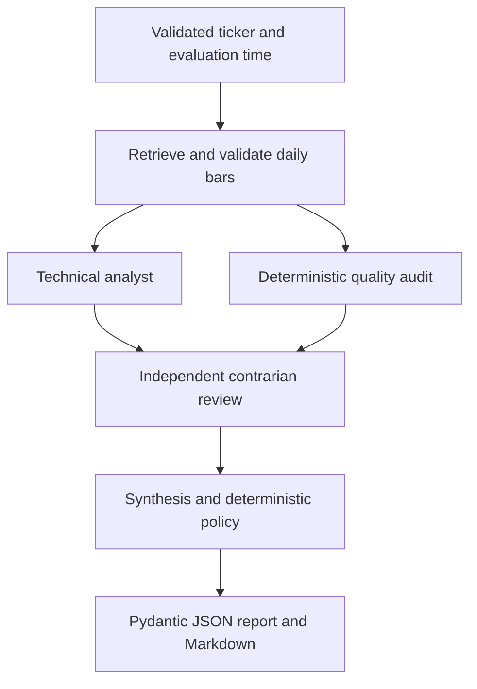

# AI Trading Desk — Market Intelligence

**A Python research workflow with independent counter-analysis and deterministic authority over model decisions.** Built as the first vertical slice of the Izzy 2.0 trading desk.

The desk validates daily OHLCV data, computes indicators, forms a technical thesis, challenges it, and produces a typed JSON report. It makes insufficient evidence and disagreement visible. It cannot place orders or access brokerage accounts.

## Run in two minutes

Requires Python 3.11+ and [uv](https://docs.astral.sh/uv/getting-started/installation/).

```bash
uv sync --locked
uv run trading-desk analyze AAPL \
  --as-of 2025-04-23T22:00:00Z \
  --output report.json --markdown report.md --verbose
uv run pytest -q
```

**Default mode is deterministic Python rules over bundled synthetic candles. No API key, LLM call, or actual AAPL market history is involved.** The ticker names the scenario. The synthetic data ends April 23, 2025; the explicit evaluation date exercises the full historical scenario without look-ahead. This is an engineering demonstration, not a backtest or market recommendation.

Without `--as-of`, evaluation uses the current UTC time. Running the same fixture today correctly produces `INSUFFICIENT_DATA` because it is stale. Reports record the actual execution time separately from the evaluation time.

Without uv:

```bash
python3 -m venv .venv
source .venv/bin/activate
pip install -e . pytest pytest-asyncio
trading-desk analyze AAPL --as-of 2025-04-23T22:00:00Z
```

## Three reviewer scenarios

```bash
# Complete history: measured historical trend and independent risk review
uv run trading-desk analyze AAPL --as-of 2025-04-23T22:00:00Z

# Strong trend versus elevated momentum: disagreement is retained; synthesis is NEUTRAL
uv run trading-desk analyze AAPL --scenario conflict --as-of 2025-04-23T22:00:00Z

# Eight candles: names the 42 missing inputs for SMA50 and abstains
uv run trading-desk analyze AAPL --scenario missing --as-of 2025-04-23T22:00:00Z

# Complete but stale data: also abstains
uv run trading-desk analyze AAPL
```

See [sample JSON](examples/sample_report.json), [readable report](examples/sample_report.md), [conflict report](examples/conflict_report.json), and [missing-data report](examples/missing_report.json). Run IDs, retrieval/execution timestamps, and durations vary; the fixture calculations and rule outcomes are deterministic.

The CLI writes JSON to stdout unless `--output` is supplied. Mode announcements and optional JSON trace events go to stderr. Exit 0 means a valid research report was produced, including abstention; exit 2 means invalid configuration or an output-write failure. Consumers must inspect `abstained`, not just the exit status.

## Actual LLM reasoning

```bash
export OPENAI_API_KEY='your-key'
export OPENAI_MODEL='gpt-4o-mini'
uv run trading-desk analyze AAPL --mode llm \
  --as-of 2025-04-23T22:00:00Z --output report.json
```

This makes separate structured-output Responses API calls for technical analysis, contrarian review, and synthesis when their required inputs are usable. Each role gets its own instructions and bounded context; there is no shared chat history. The contrarian gets source bars, measurements, and the initial thesis. Synthesis receives both assessments. The provider is injected through a small Python `Protocol`; tests use independent fake providers.

A data gate or required-agent abstention skips downstream model calls. Malformed, incomplete, refused, or unavailable model responses produce recorded abstention; they never silently switch to rule-based success. Structured measurement references must match deterministic values. Final policy enforces abstention and prevents a directional synthesis from erasing bullish/bearish disagreement.

`OPENAI_MODEL` is configurable and must support Responses structured outputs. `.env.example` is a reference only: export variables yourself; there is no automatic dotenv loader. Requests set `store=false`. Model outputs still require evaluation: schema validation and grounded measurement references do not prove prose is true or a thesis is useful.

**Verification status:** the LLM request/response contract, error handling, and orchestration are tested with HTTP mocks and injected providers. No paid model call or authenticated market-data request was used to generate the included reports.

## Optional external market data

```bash
export ALPHAVANTAGE_API_KEY='your-key'
uv run trading-desk analyze AAPL --source alpha-vantage --output report.json
# Add --mode llm to use model reasoning over external daily bars.
```

The adapter uses Alpha Vantage `TIME_SERIES_DAILY`, compact output, with unadjusted daily bars. An API key is required; account quotas and entitlements apply. This is a provider retrieval path, not a streaming or guaranteed real-time quote feed. Session dates are represented as midnight UTC date labels, not exact trade timestamps. Price splits/dividends may distort unadjusted indicators. The adapter records source, interval, retrieval time, candles, and errors. It never substitutes synthetic data after an external failure.

Transport errors, HTTP 429, and server failures have a three-attempt budget with bounded backoff; other HTTP failures are not retried. HTTP-200 quota/symbol-error payloads become explicit errors. Each HTTP request has a timeout and each workflow provider call has an overall deadline. Logs exclude exception bodies and provider payloads to avoid leaking credentials through URLs.

## Workflow and authority



The explicit LangGraph `StateGraph` uses typed shared state with validated Pydantic domain objects. Technical interpretation and quality auditing are independent branches with an explicit join before review. The append reducer merges their trace events safely. Agents cannot select arbitrary tools, execute code, place orders, or change the graph. The graph is acyclic and bounded.

| Layer | Responsibility | Authority |
|---|---|---|
| Data adapter | Retrieve and validate chronological OHLCV | Reject malformed bars and symbol mismatches |
| Indicators | SMA20/50, Wilder RSI14/ATR14, 20-session return | Sole source of reported measurements |
| Quality audit | History length, freshness, large gaps | Deterministic abstention gate |
| Technical analyst | Historical trend interpretation | Propose research stance |
| Contrarian reviewer | Counter-evidence and risk scenarios | Preserve dissent; may abstain |
| Synthesis | Reconcile both interpretations | Cannot override deterministic constraints |

Rules and LLM mode use the same graph and domain contracts. Rules mode is a transparent baseline, **not a multi-agent LLM execution**. In LLM mode, the agents are specialized stateless reasoning calls coordinated by the graph.

## Reliability decisions

- Bars must have positive finite prices, nonnegative volume, coherent OHLC bounds, and unique increasing timestamps. Invalid provider batches fail closed rather than dropping unknown rows silently.
- Bars later than the evaluation time are removed before calculations. Historical replay cannot use future candles. Future evaluation timestamps are rejected.
- At least 50 valid candles are required for a complete trend assessment. Unavailable indicators are `null`, never zero-filled.
- Data older than five calendar days, or a gap exceeding five calendar days, triggers abstention. This is a conservative heuristic, not an exchange-calendar completeness guarantee. It tolerates ordinary weekends and many holidays; exceptional closures may yield false abstention.
- RSI and ATR use Wilder smoothing over 14 close changes/true ranges. Flat RSI is defined as 50; no losses gives 100; no gains gives 0. ATR needs 15 bars because this implementation starts true ranges with a previous close. SMA50 includes the latest close. Twenty-session return requires 21 closes.
- Opposite bullish/bearish agent classifications require a neutral synthesis or abstention. All differing classifications are retained in `dissent`.
- Partial measurements and successful agent outputs survive provider/model failures. Final classification is `INSUFFICIENT_DATA` when any required stage cannot support a conclusion.
- Every node emits a trace containing run ID, role, status, duration, provider/model, and sanitized errors. No reasoning transcripts or API keys are logged. Tracing is local; hosted tracing is not required.

## Tests and quality checks

```bash
uv run pytest -q
uv run ruff check .
uv run ruff format --check .
```

Tests cover known indicator values and boundaries, malformed OHLCV, duplicate timestamps, graph propagation, historical filtering, stale/missing data, provider failure and redaction, unsupported fixture symbols, contrary assessments, policy overrides, malformed model output, fabricated measurements, skipped model calls, HTTP request shapes, quota responses, bounded retries, and CLI artifacts. CI is configured for Python 3.11–3.14. CI results become available after publication; local validation is documented in [BUILD_STATUS.md](BUILD_STATUS.md).

## Code map

```text
src/trading_desk/
  models.py              Domain contracts and report invariants
  graph.py               Explicit workflow, quality gates, provider boundaries
  llm.py                 Reasoning provider protocol and OpenAI HTTP adapter
  cli.py                 CLI and Markdown renderer
  agents/                Technical, contrarian, synthesis baseline logic
  tools/                 Data adapters and deterministic indicator math
  fixtures/              Clearly synthetic scenario JSON
 tests/                  Deterministic unit, integration, HTTP and CLI tests
 examples/               Generated, validated demo reports
```

## Scope and next steps

Implemented: executable graph, specialized analysis/review/synthesis, deterministic quality gates, JSON/Markdown reports, CLI, mock-tested LLM and external data adapters, local tracing, and tests.

Not implemented: current news/catalysts, fundamentals, exchange calendars, adjusted price history, scanning, backtests, paper orders, broker integrations, dashboard, persistence, deployment, or claims of predictive performance. The deterministic baseline uses SMA ordering for trend and RSI extremes for counter-scenarios; it is deliberately simple and uncalibrated. No confidence percentages, return guarantees, or position recommendations are produced.

Next work should prioritize a recorded credentialed LLM evaluation, licensed historical fixtures, exchange calendars, and a small labeled evaluation set before adding news or more agents. Existing React charting can consume this report contract later. Shared workflow and provider patterns can inform other Izzy 2.0 desks after they prove useful here.

## Publishing

This directory is a standalone Git repository. Once authenticated with the intended GitHub account:

```bash
gh auth login
gh repo create ai-trading-desk --public --source . --remote origin --push
```

Review the files and public repository contents before sending the URL. Credentials belong in environment variables and are excluded from version control. No brokerage execution exists.

## References

- [LangGraph graph API](https://docs.langchain.com/oss/python/langgraph/graph-api)
- [OpenAI structured outputs](https://developers.openai.com/api/docs/guides/structured-outputs)
- [Alpha Vantage daily API](https://www.alphavantage.co/documentation/#daily)
